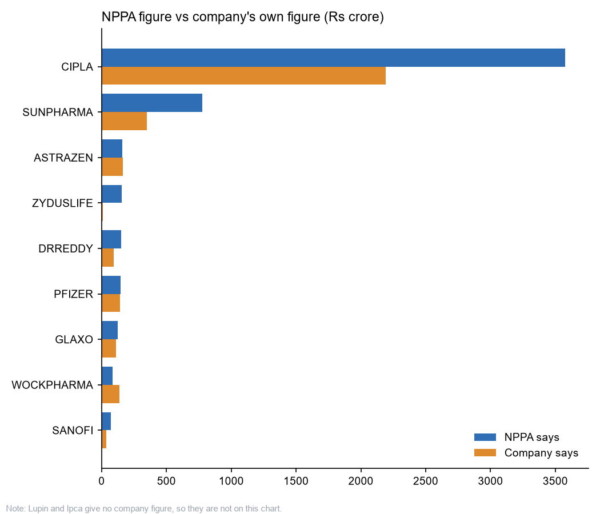
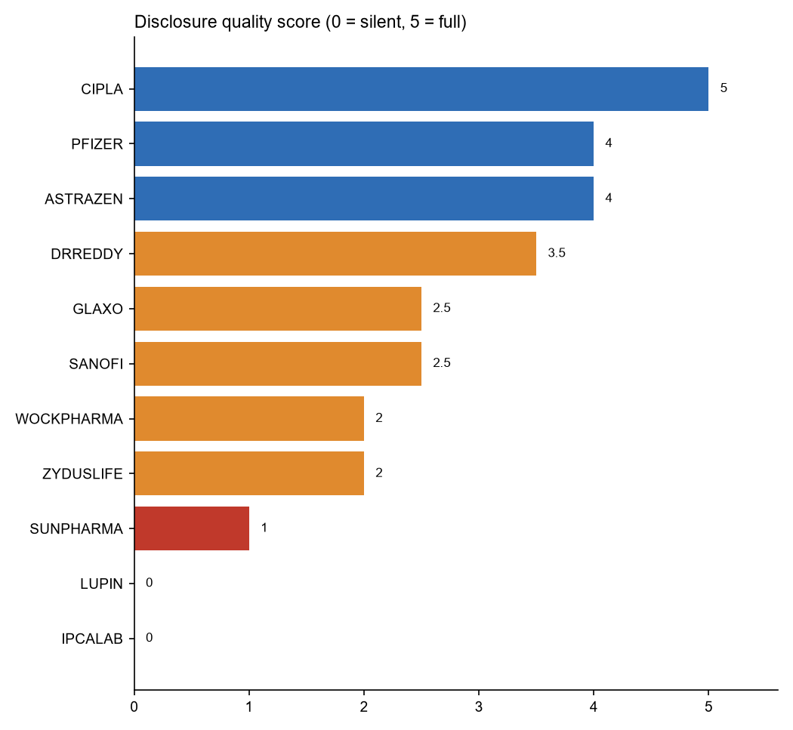
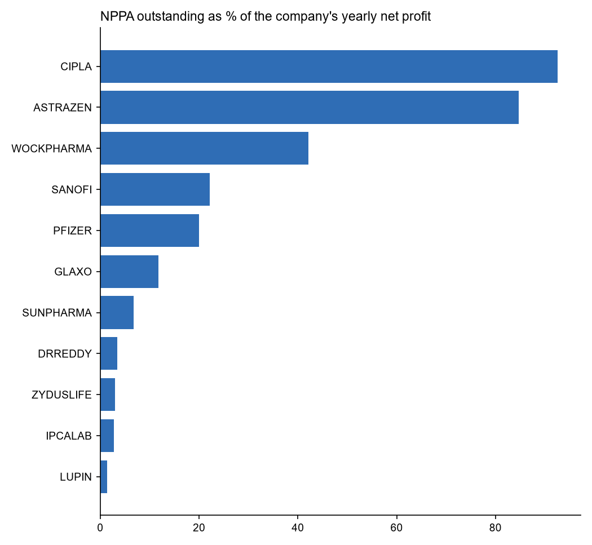

# NPPA Overcharging Demands vs Company Disclosures

**The question:** NPPA (National Pharmaceutical Pricing Authority) publishes how much money it says drug companies owe for overcharging patients above the government's ceiling price — do listed companies show the same amount to investors in their annual reports, and if not, do they explain the gap?

## Main findings

- **6 of 11 companies checked disclose less than NPPA says, or nothing at all, with no explanation.**
- **Disclosure quality follows materiality** — the companies for whom the NPPA amount is a bigger share of profit tend to disclose it more carefully; companies for whom it's a small slice of profit are more often silent or vague.
- **AstraZeneca is the cleanest three-way match found**: its foreign parent's own US SEC filing ("approximately $21 million plus interest" for the Tagrisso case), the Indian subsidiary's own annual report (₹157.39 cr), and NPPA's own list (₹158.75 cr) all line up closely.
- **No share-price reaction was found** for the two AstraZeneca events tested — both had |t| well under 1, far from the usual significance threshold. With only 2 events this is a case study, not proof.

## Charts

**NPPA's figure vs each company's own figure:**



**Disclosure quality score (0 = silent, 5 = full):**



**NPPA's outstanding amount as a % of each company's yearly profit:**



## Folder layout

```
NPPA_Project\
│  ROADMAP.md                     <- step-by-step instructions for every script
│  README.md                      <- this file
│  config.py                      <- all folder paths and settings
│  utils.py                       <- small shared helpers
│  requirements.txt                <- Python libraries needed
│  00_check_setup.py ... 10_build_report.py   <- the 11 pipeline steps, run in order
│
└─ data\
   ├─ input\        <- CSV files you edit by hand
   │     company_aliases.csv       NPPA name patterns -> listed company
   │     annual_reports.csv        link to each company's annual report PDF
   │     company_disclosures.csv   what each company's annual report says, hand-checked
   │     financials.csv            revenue, net profit, net worth per company
   │     events.csv                dates of NPPA announcements, for the share-price study
   │     list_dates_manual.csv     dates typed in by hand for undated NPPA list PDFs
   ├─ annual_reports\   <- downloaded annual report PDFs
   └─ output\           <- everything the scripts produce (CSV/Excel, charts, the final report)
         charts\            <- all PNG charts
         disclosures\       <- the NPPA/DPCO passages found in each annual report
         FINAL_REPORT.md    <- the generated report with [bracketed] parts to fill in by hand
```

## How to run it

1. `pip install -r requirements.txt`
2. Install Tesseract OCR (only needed for scanned PDFs in step 01) — see ROADMAP.md section 2.4.
3. **Before step 02 can do anything**, NPPA's "Status of Overcharging Cases" PDFs need to already be on disk — either crawl them yourself or download them by hand from nppa.gov.in, and point `CRAWLER_DOWNLOADS` in `config.py` at that folder.
4. **Before step 05 can do anything**, each company's annual report link needs to be filled in `data\input\annual_reports.csv` — step 04 downloads them from there.
5. Run the steps in order: `00_check_setup.py` through `10_build_report.py`. Each script prints what it did and what to check next; see `ROADMAP.md` for the full explanation of every step, every input you need to fill in by hand, and every output file.

## Data sources

- NPPA's "Status of Overcharging Cases" PDFs (nppa.gov.in) — the regulator's own master list of overcharging demands.
- Each company's own annual report (NSE/BSE/company website), read by hand for the NPPA/DPCO notes, the auditor's key audit matter, and the financial statements.
- US SEC EDGAR full-text search (sec.gov/edgar/search) — foreign parent companies' 20-F/6-K filings that mention NPPA.
- NSE/BSE corporate announcements and Yahoo Finance share prices, for the event study.
- The Parliamentary Standing Committee report (6 Aug 2026, summarised by PRS Legislative Research) — used as an independent check on NPPA's own total.

## Full report

The complete write-up, with every number explained and the per-company detail, is in [data/output/FINAL_REPORT_final.md](data/output/FINAL_REPORT_final.md).

`data/output/FINAL_REPORT.md` is the first draft that `10_build_report.py` generates automatically (with [bracketed] parts to be written by hand); `FINAL_REPORT_final.md` is the finished version.

## Not included in this repository

- **The company annual reports** (`data/annual_reports/`, about 170 MB of PDFs). They are the companies' own documents and are freely available on NSE, BSE and each company's website; the links are listed in `data/input/annual_reports.csv`. The NPPA/DPCO passages actually used are saved in `data/output/disclosures/`.
- **NPPA's original PDF lists**, which are downloaded from nppa.gov.in (see "How to run it", step 3).

## Disclaimer

Based only on public documents. Research, not legal or investment advice. Figures may contain errors; see the report's limitations.
