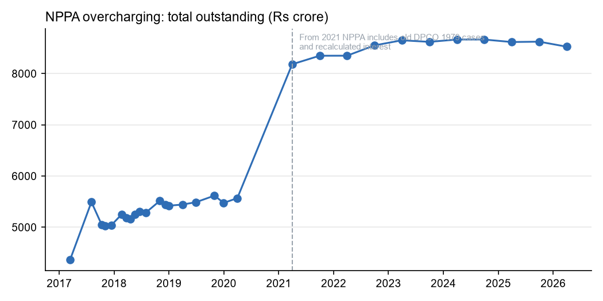
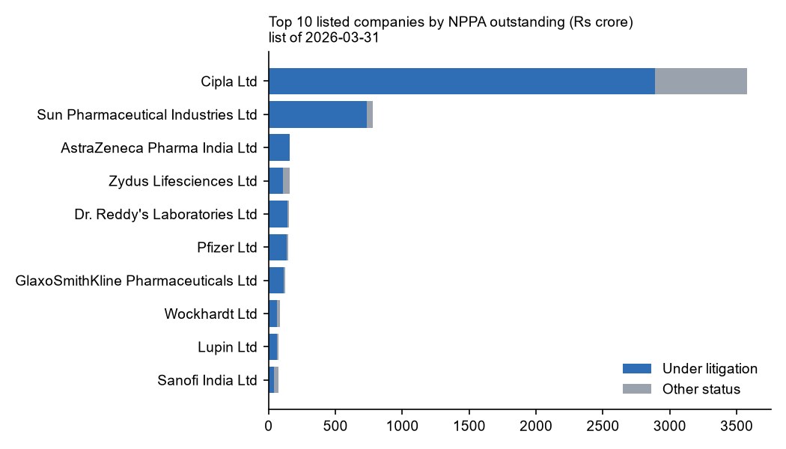
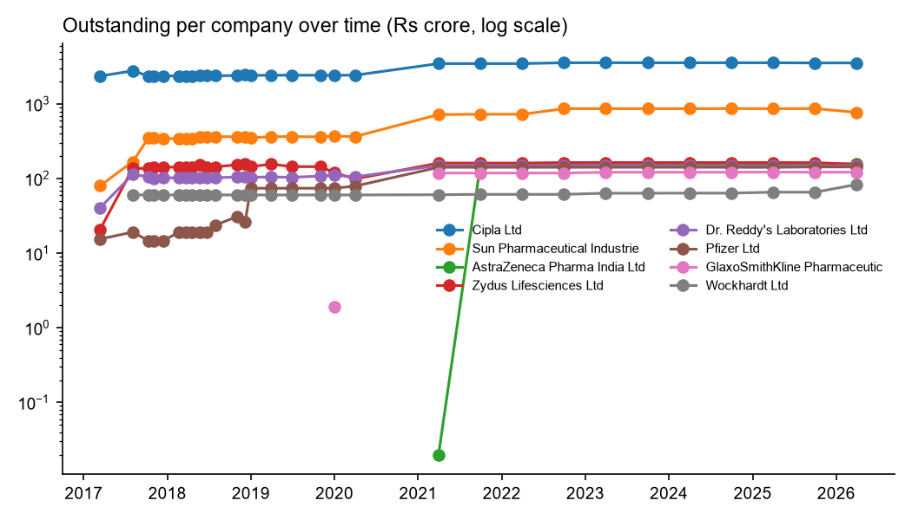
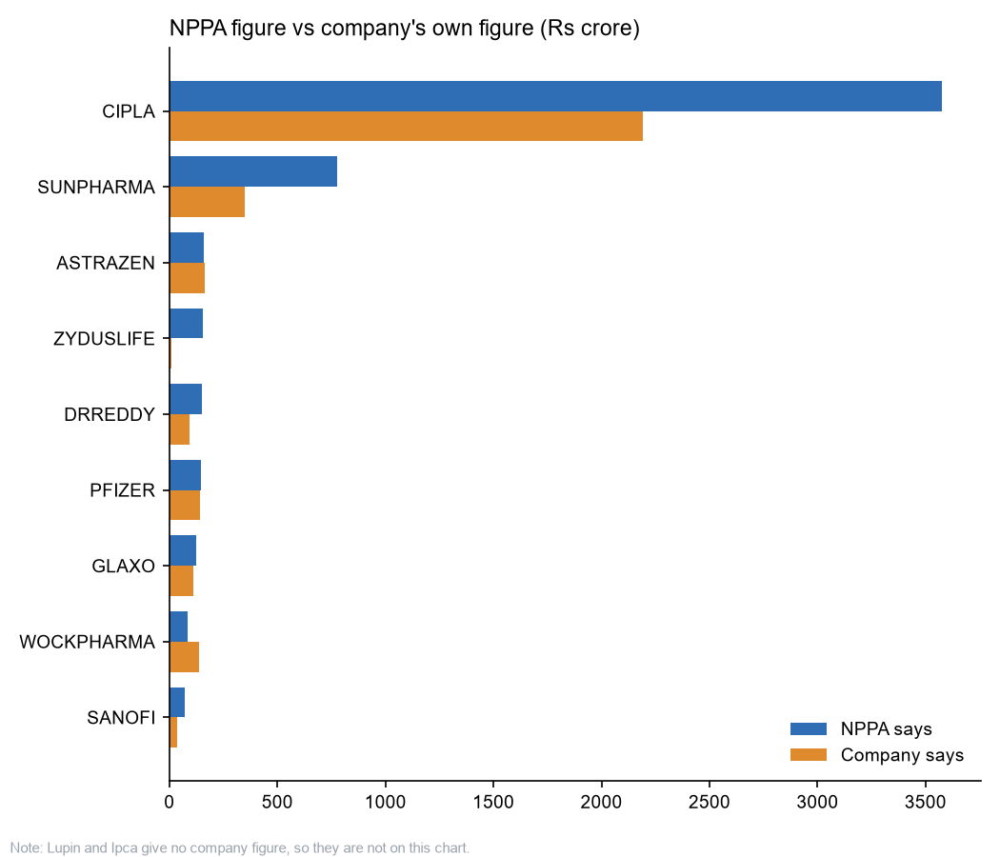
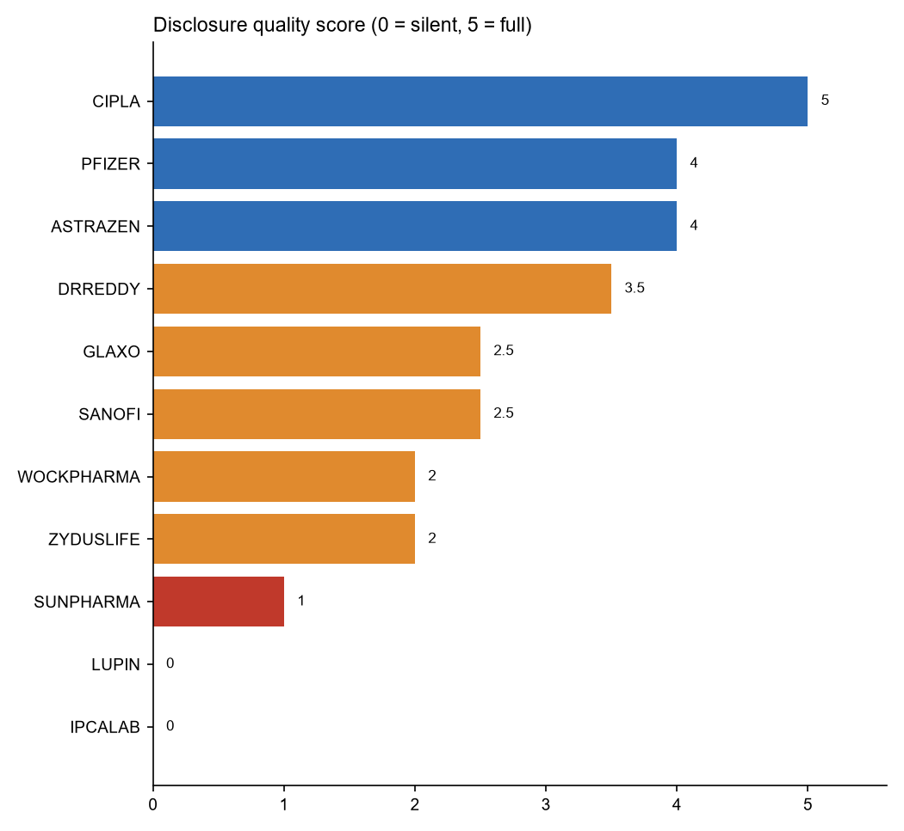
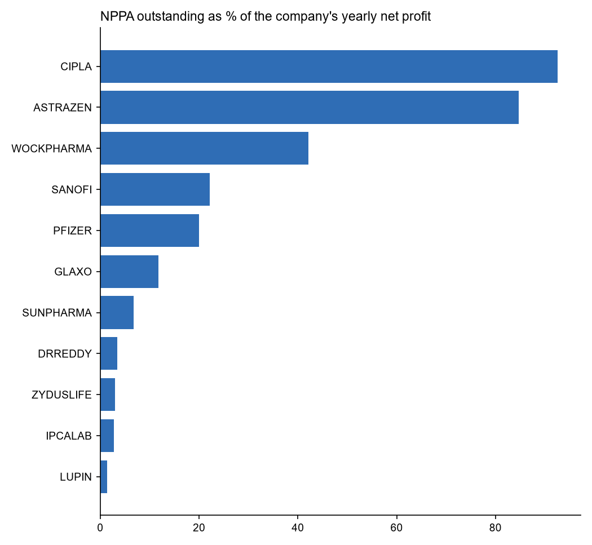

# NPPA overcharging demands vs company disclosures
### Does what India's drug-price regulator says companies owe match what the companies tell investors?

_Report generated 2026-11-18 19:04. Numbers come from the project's scripts; text in [brackets] is for you to write._

---

## 1. Summary (write this last)
- **Question:** NPPA publishes, company by company, the money it says drug makers owe for overcharging above
  government ceiling prices. Do listed companies disclose the same exposure in their annual reports?
- **Data:** 58 NPPA status lists (2019–2026), 11 company annual reports checked by reconciliation.
- **Main finding:** 6 of 11 companies checked show a big unexplained gap or give no figure. [Explain in 2–3 sentences.]
- **Why it matters for investors:** [Materiality: how large is the exposure vs profit / net worth?]
- **International angle:** [What foreign parents say in US SEC filings vs the Indian subsidiary.]

## 2. Background (regulatory layer)
[Explain in your words: NPPA, DPCO 1979 / 1987 / 1995 / 2013, ceiling prices, how overcharging demands with
interest are raised, why most money is stuck in court (~70% under litigation per the Parliamentary
Standing Committee report of Aug 2026), and the committee's recommendation for a legal cell.]

## 3. NPPA's side: what the regulator says

*Total outstanding across all NPPA lists*

*Top 10 listed companies, latest NPPA list*

**Latest list – top listed companies (Rs crore)**

| listed_company | nse_symbol | outstanding_crore | outstanding_litigation_crore | share_under_litigation_pct | cases |
|---|---|---|---|---|---|
| Cipla Ltd | CIPLA | 3576.54 | 2889.47 | 80.8 | 79 |
| Sun Pharmaceutical Industries Ltd | SUNPHARMA | 777.99 | 736.29 | 94.6 | 63 |
| AstraZeneca Pharma India Ltd | ASTRAZEN | 158.75 | 157.39 | 99.1 | 3 |
| Zydus Lifesciences Ltd | ZYDUSLIFE | 155.97 | 107.15 | 68.7 | 33 |
| Dr. Reddy's Laboratories Ltd | DRREDDY | 149.4 | 143.12 | 95.8 | 31 |
| Pfizer Ltd | PFIZER | 144.17 | 135.82 | 94.2 | 19 |
| GlaxoSmithKline Pharmaceuticals Ltd | GLAXO | 122.64 | 114.04 | 93.0 | 7 |
| Wockhardt Ltd | WOCKPHARMA | 83.73 | 61.35 | 73.3 | 4 |
| Lupin Ltd | LUPIN | 74.02 | 60.18 | 81.3 | 31 |
| Sanofi India Ltd | SANOFI | 72.37 | 40.44 | 55.9 | 14 |
| Novartis India Ltd | NOVARTIND | 46.32 | 46.2 | 99.7 | 4 |
| Lyka Labs Ltd | LYKALABS | 44.12 | 18.62 | 42.2 | 9 |
| Procter & Gamble Health Ltd | PGHL | 35.57 | 35.57 | 100.0 | 3 |
| Ipca Laboratories Ltd | IPCALAB | 33.49 | 24.13 | 72.1 | 22 |
| Kopran Ltd | KOPRAN | 24.22 | 24.22 | 100.0 | 5 |

*Company outstanding over time*

[What changed between 2019 and 2026? Which companies grew / fell? New cases vs old ones?]

## 4. The companies' side and the reconciliation (finance layer)

*NPPA figure vs company figure*

| NSE symbol | NPPA outstanding (Rs cr) | Company figure (Rs cr) | Gap NPPA minus company (Rs cr) | Provision booked (Rs cr) | Disclosure score (0-5) | Verdict |
|---|---|---|---|---|---|---|
| CIPLA | 3576.54 | 2192.95 | 1383.59 | 171.99 | 5.0 | Big gap, explained by company |
| SUNPHARMA | 777.99 | 347.42 | 430.57 |  | 1.0 | BIG UNEXPLAINED GAP |
| ASTRAZEN | 158.75 | 164.49 | -5.74 | 7.1 | 4.0 | Matches (gap small) |
| ZYDUSLIFE | 155.97 | 7.9 | 148.07 |  | 2.0 | BIG UNEXPLAINED GAP |
| DRREDDY | 149.4 | 94.9 | 54.5 | 52.1 | 3.5 | BIG UNEXPLAINED GAP |
| PFIZER | 144.17 | 140.29 | 3.88 | 19.39 | 4.0 | Matches (gap small) |
| GLAXO | 122.64 | 112.53 | 10.11 | 123.42 | 2.5 | Matches (gap small) |
| WOCKPHARMA | 83.73 | 136.0 | -52.27 |  | 2.0 | COMPANY SHOWS MORE THAN NPPA |
| LUPIN | 74.02 |  |  |  | 0.0 | BIG EXPOSURE, NO COMPANY FIGURE |
| SANOFI | 72.37 | 36.7 | 35.67 | 36.7 | 2.5 | BIG UNEXPLAINED GAP |
| IPCALAB | 33.49 |  |  |  | 0.0 | BIG EXPOSURE, NO COMPANY FIGURE |

*Disclosure quality score*

*Exposure vs net profit*

**Company by company** [one short paragraph each: what the company says, the gap, its stated reason, how it is
accounted for (provision vs contingent liability under Ind AS 37), auditor key audit matter or not].

## 5. Market reaction (event study)
| nse_symbol | event_date | event_type | amount_crore | CAR[-1,1]_% | t[-1,1] | p[-1,1] | status |
|---|---|---|---|---|---|---|---|
| ASTRAZEN | 2026-07-31 | new demand notice | 148.66 | 0.77 | 0.32 | 0.752 | ok |
| ASTRAZEN | 2025-09-12 | show cause notice | 60.5 | -0.42 | -0.09 | 0.932 | ok |

[Interpretation. With few events, describe them as case studies.]

## 6. International comparison
| company | form | file_date | amounts_seen | url |
|---|---|---|---|---|
| DR REDDYS LABORATORIES LTD | 6-K | 2026-06-30 |  | https://www.sec.gov/Archives/edgar/data/1135951/000157587226000464/rdy0913_99-1.pdf |
| DR REDDYS LABORATORIES LTD | 20-F | 2026-05-29 | Rs.181 | https://www.sec.gov/Archives/edgar/data/1135951/000157587226000381/rdy0899_20f.htm |
| Grifols SA | 20-F | 2026-04-17 |  | https://www.sec.gov/Archives/edgar/data/1438569/000110465926044901/grfs-20251231x20f.htm |
| DR REDDYS LABORATORIES LTD | 6-K | 2026-01-21 |  | https://www.sec.gov/Archives/edgar/data/1135951/000157587226000031/rdy0842_6k.htm |
| DR REDDYS LABORATORIES LTD | 6-K | 2025-10-24 |  | https://www.sec.gov/Archives/edgar/data/1135951/000157587225000631/rdy0810_6k.htm |
| DR REDDYS LABORATORIES LTD | 6-K | 2025-07-23 |  | https://www.sec.gov/Archives/edgar/data/1135951/000157587225000484/rdy779_6k.htm |
| DR REDDYS LABORATORIES LTD | 20-F | 2025-06-06 | Rs.39; Rs.61 | https://www.sec.gov/Archives/edgar/data/1135951/000157587225000393/rdy-20250331.htm |
| Grifols SA | 20-F | 2025-04-11 |  | https://www.sec.gov/Archives/edgar/data/1438569/000110465925034245/grfs-20241231x20f.htm |
| DR REDDYS LABORATORIES LTD | 6-K | 2025-01-23 |  | https://www.sec.gov/Archives/edgar/data/1135951/000157587225000080/drr0714_6k.htm |
| DR REDDYS LABORATORIES LTD | 6-K | 2024-11-05 |  | https://www.sec.gov/Archives/edgar/data/1135951/000157587224001124/drr0687_6k.htm |
| DR REDDYS LABORATORIES LTD | 6-K | 2024-07-29 |  | https://www.sec.gov/Archives/edgar/data/1135951/000157587224000831/drr0647_6k.htm |
| DR REDDYS LABORATORIES LTD | 20-F | 2024-06-12 | Rs.39; Rs.61 | https://www.sec.gov/Archives/edgar/data/1135951/000157587224000660/rdy-20240331.htm |
| DR REDDYS LABORATORIES LTD | 20-F | 2023-06-13 | Rs.1,064; Rs.39; Rs.59 | https://www.sec.gov/Archives/edgar/data/1135951/000157587223000951/rdy-20230331.htm |
| DR REDDYS LABORATORIES LTD | 20-F | 2022-06-27 | Rs.1,774; Rs.1,971; Rs.39; Rs.57 | https://www.sec.gov/Archives/edgar/data/1135951/000157587222000576/rdy-20220331.htm |
| ASTRAZENECA PLC | 20-F | 2022-02-22 | $ 21 m; $ 21.5 million | https://www.sec.gov/Archives/edgar/data/901832/000110465922025720/azn-20211231x20f.htm |
| ASTRAZENECA PLC | 20-F | 2022-02-22 | $21.5 million; $21m | https://www.sec.gov/Archives/edgar/data/901832/000110465922025720/azn-20211231xex15d1.htm |
| DR REDDYS LABORATORIES LTD | 6-K | 2022-01-28 | Rs.342 | https://www.sec.gov/Archives/edgar/data/1135951/000157587222000050/drr0357_6k.htm |
| DR REDDYS LABORATORIES LTD | 6-K | 2021-11-08 |  | https://www.sec.gov/Archives/edgar/data/1135951/000157587221000310/drr0347_ex99-2.htm |
| DR REDDYS LABORATORIES LTD | 6-K | 2021-11-05 |  | https://www.sec.gov/Archives/edgar/data/1135951/000157587221000303/drr0345_6k.htm |
| ASTRAZENECA PLC | 6-K | 2021-07-30 | $ 21 m | https://www.sec.gov/Archives/edgar/data/901832/000110465921097781/tmb-20210630x6k.htm |

[Compare: parent's US filing amount vs Indian subsidiary's figure vs NPPA's figure. Also compare how other
regulators publish such data, e.g. whether any regulator publishes company-wise unpaid amounts like NPPA.]

## 7. Method (data science layer)
1. Crawled nppa.gov.in (≈2,500 files), de-duplicated by SHA-256, converted PDFs to text/Markdown with OCR for scans.
2. Parsed every "Status of Overcharging Cases" PDF into one table (split merged cells, lakh → crore).
3. Matched ~1,000 raw company names to listed companies with pattern rules + fuzzy-match suggestions.
4. Searched annual reports for NPPA/DPCO passages; filled the reconciliation by reading the notes.
5. Computed gaps, disclosure scores, materiality ratios; market-model event study (Nifty 50 / Nifty Pharma).
6. Searched SEC EDGAR full text for parent-company disclosures.

## 8. Limitations
- PDF table parsing is imperfect: rows flagged for review were checked by hand [say how many].
- "Not found" in an annual report search ≠ not disclosed; every such case was read by hand [confirm].
- NPPA lists and annual reports may use different dates, interest calculations and duplicate notices.
- Few market events → event study is illustrative, not statistical proof.
- This is research, not legal or investment advice.

## 9. Resume bullet points (edit to your final numbers)
- Built a Python pipeline that crawled ~2,500 NPPA documents, OCR'd scans and parsed 58 overcharging lists (2019–2026) into a company-level panel.
- Reconciled NPPA's company-wise overcharging dues with 11 listed pharma companies' Ind AS 37 disclosures; found 6 with large unexplained gaps or no disclosure.
- Measured financial materiality and share-price reaction (market-model event study) to NPPA demand notices; compared with parent-company SEC filings.

## Sources
- NPPA – Status of Overcharging Cases (lists on nppa.gov.in)
- Company annual reports (see data/input/annual_reports.csv)
- PRS Legislative Research – summary of the Standing Committee report on NPPA (Aug 2026)
- SEC EDGAR full-text search
