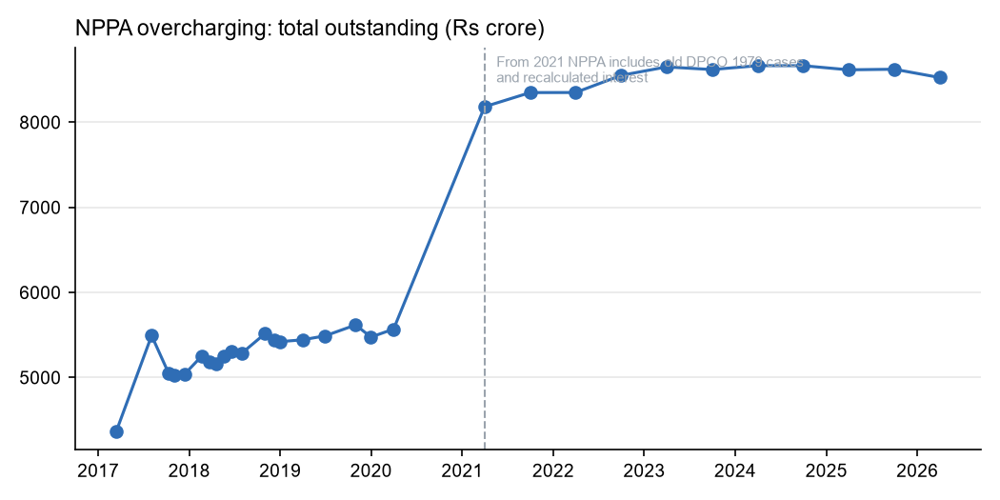
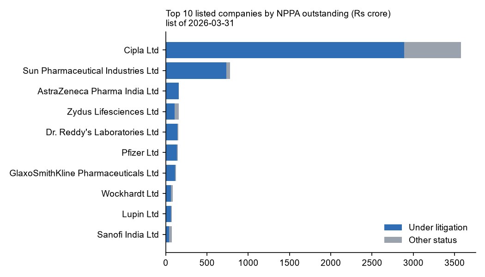
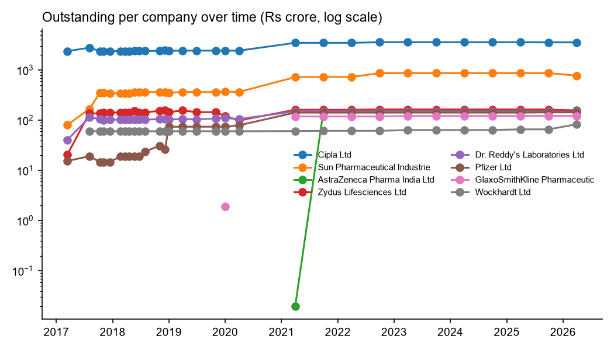
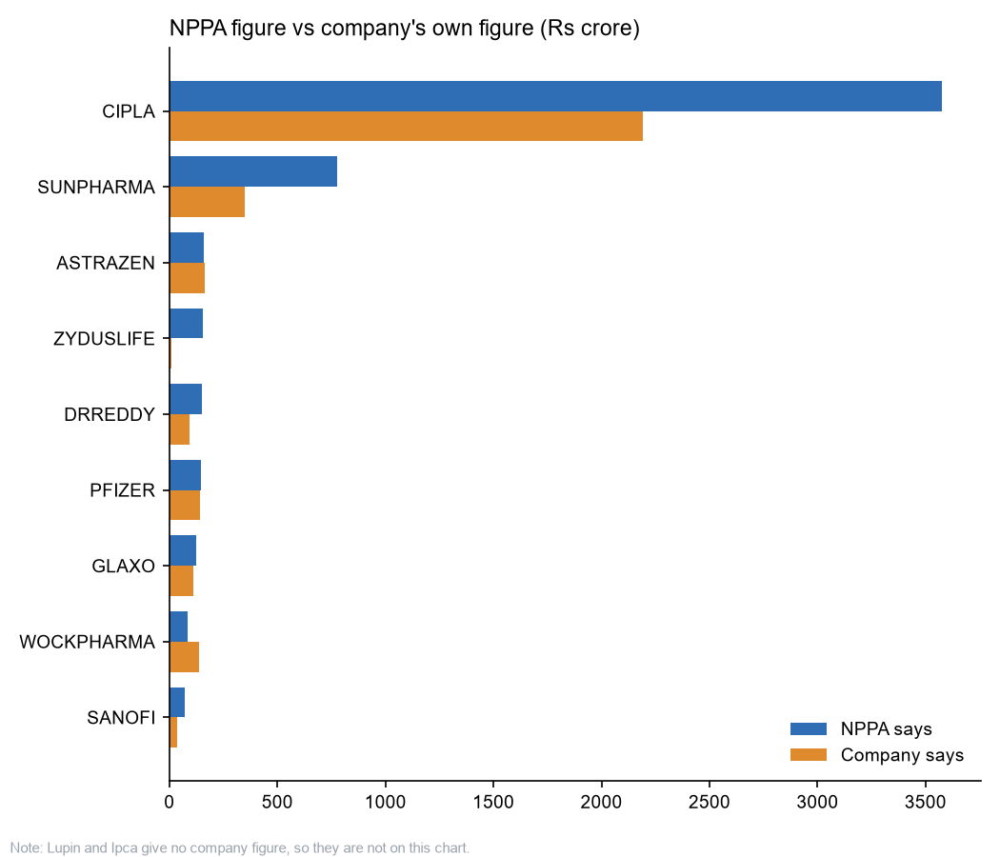
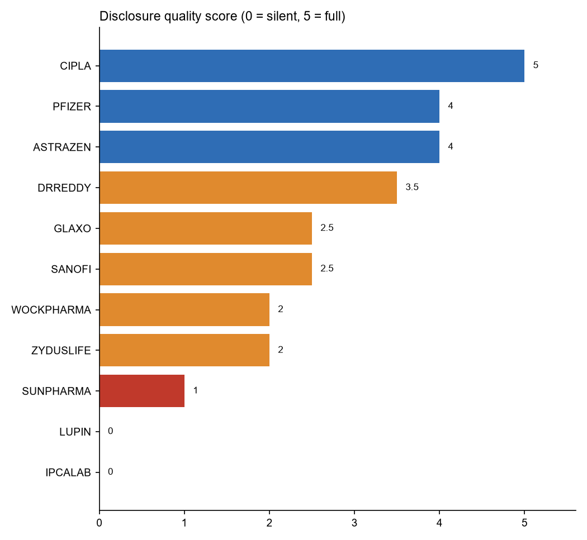
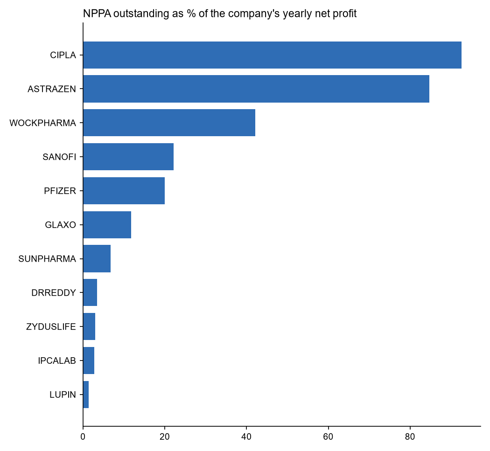

# NPPA overcharging demands vs company disclosures
### Does what India's drug-price regulator says companies owe match what the companies tell investors?

_Data as of 18 November 2026. Numbers come from the project's scripts and from the companies' own reports; every company figure was checked against its annual report._

---

## 1. Summary

- **Question:** NPPA publishes, company by company, the money it says drug makers owe for selling medicines above government ceiling prices. Do listed companies disclose the same exposure in their annual reports?
- **Data:** 30 NPPA company-wise overcharging lists (March 2017 to March 2026, including one list recovered from an undated PDF by reading its own text, taken from 58 crawled files), the FY2025-26 annual reports of the 11 listed companies with the largest NPPA dues (Sanofi: calendar year 2025), stock prices, stock-exchange filings and US SEC filings.
- **Main finding:** 6 of 11 companies show less than NPPA claims, or nothing at all, without explaining why (Sun Pharma, Zydus, Dr. Reddy's, Sanofi, Lupin, Ipca). 4 match NPPA or explain the difference (Cipla, AstraZeneca, Pfizer, GSK), and 1 shows more than NPPA (Wockhardt). The best and worst cases sit side by side: Cipla explains its ₹3,577 crore exposure line by line, while Lupin and Ipca do not mention NPPA anywhere.
- **Why it matters for investors:** disclosure follows materiality. Every company whose NPPA claim is above about 10% of a year's profit gives a figure for it (Cipla 92.6%, AstraZeneca 84.7%). Every company below 7% is in the unexplained group (Sun 6.8%, Dr. Reddy's about 3.5%, Zydus 3.0%, Ipca 2.8%, Lupin 1.4%). That is allowed by materiality rules, but it means that for about half the companies, NPPA's public list is the only place an investor can see the claim.
- **International angle:** only AstraZeneca's UK parent ever put a number on an NPPA demand in its US filings (about $21 million plus interest for Tagrisso). It matches both the Indian company (₹157.39 crore) and NPPA (₹158.75 crore). Pfizer Inc., Sanofi, GSK plc and Abbott never name NPPA. Materiality hides the claim at two levels: small claims drop out of Indian reports, and Indian claims drop out of global parents' reports.

## 2. Background (regulatory layer)

India caps the price of many medicines, and when a company sells above the cap, the government demands the extra money back with interest. The National Pharmaceutical Pricing Authority (NPPA), set up in 1997 under the Department of Pharmaceuticals, Ministry of Chemicals and Fertilizers, fixes these ceiling prices, monitors the prices of all medicines and recovers overcharged amounts.

Prices are controlled through Drugs (Prices Control) Orders (DPCOs), issued under the Essential Commodities Act, 1955. The DPCOs of 1979, 1987 and 1995 fixed prices based on the cost of production; the 1995 order covered 74 bulk drugs and their formulations. The 1979 order also created the Drug Prices Equalisation Account (DPEA), into which companies had to pay certain price differences. DPCO 2013 is market-based: for medicines in the National List of Essential Medicines, the ceiling price is the simple average price of all brands with at least 1% market share, and other medicines may raise their price by no more than 10% a year. Cases from all four orders are still open.

When NPPA finds that a company sold above the allowed price, it usually sends a show-cause notice first, asking the company to explain. It then works out the overcharged amount for the period, adds interest, and issues a demand notice. The company can pay, deposit part of the amount, or challenge the demand in court. Most choose court: the Parliamentary Standing Committee report of August 2026 (as summarised by PRS Legislative Research) found ₹8,526 crore, about 85% of overcharged amounts, unrecovered, about 70% of it under litigation, with some cases more than 20 years old. The Committee recommended a dedicated legal cell inside NPPA to pursue these cases.

For accounting, Indian companies follow Ind AS 37. A payment that is probable and can be estimated is booked as a **provision** (an expense that reduces profit). A payment that is only possible is a **contingent liability**, described in the notes without an expense. A payment that is remote needs no disclosure. Most NPPA demands under court challenge are treated as contingent liabilities.

## 3. NPPA's side: what the regulator says

*Total outstanding across all NPPA lists*

*Top 10 listed companies, latest NPPA list*

**Latest list – top listed companies (Rs crore)**

| listed_company | nse_symbol | outstanding_crore | outstanding_litigation_crore | share_under_litigation_pct | cases |
|---|---|---|---|---|---|
| Cipla Ltd | CIPLA | 3576.54 | 2889.47 | 80.8 | 79 |
| Sun Pharmaceutical Industries Ltd | SUNPHARMA | 777.99 | 736.29 | 94.6 | 63 |
| AstraZeneca Pharma India Ltd | ASTRAZEN | 158.75 | 157.39 | 99.1 | 3 |
| Zydus Lifesciences Ltd | ZYDUSLIFE | 155.97 | 107.15 | 68.7 | 33 |
| Dr. Reddy's Laboratories Ltd | DRREDDY | 149.4 | 143.12 | 95.8 | 31 |
| Pfizer Ltd | PFIZER | 144.17 | 135.82 | 94.2 | 19 |
| GlaxoSmithKline Pharmaceuticals Ltd | GLAXO | 122.64 | 114.04 | 93.0 | 7 |
| Wockhardt Ltd | WOCKPHARMA | 83.73 | 61.35 | 73.3 | 4 |
| Lupin Ltd | LUPIN | 74.02 | 60.18 | 81.3 | 31 |
| Sanofi India Ltd | SANOFI | 72.37 | 40.44 | 55.9 | 14 |
| Novartis India Ltd | NOVARTIND | 46.32 | 46.2 | 99.7 | 4 |
| Lyka Labs Ltd | LYKALABS | 44.12 | 18.62 | 42.2 | 9 |
| Procter & Gamble Health Ltd | PGHL | 35.57 | 35.57 | 100.0 | 3 |
| Ipca Laboratories Ltd | IPCALAB | 33.49 | 24.13 | 72.1 | 22 |
| Kopran Ltd | KOPRAN | 24.22 | 24.22 | 100.0 | 5 |

*Company outstanding over time*

NPPA's total outstanding stood at ₹8,526.16 crore in the March 2026 list. It was about ₹4,400 crore in March 2017 and between ₹5,000 and ₹5,600 crore from 2018 to March 2020 (values read from the chart, approximate). It then jumped to about ₹8,183 crore by March 2021 and ₹8,349 crore by September 2021, and has stayed between about ₹8,500 and ₹8,650 crore ever since. The flat line since 2022 is the main point: old demands are not being recovered, and the total falls only slightly (₹8,623 crore in September 2025 to ₹8,526 crore in March 2026).

The rise between 2020 and 2021 is now explained. No NPPA list was found dated between March 2020 and September 2021, but a detailed company-wise list for March 2021 was recovered from an undated PDF ("Detailed-Sheet-latest") whose own text read "upto March, 2021"; it put the total at about ₹8,183 crore already. NPPA's own year-wise summaries (aggregate totals only, not company lists) show the total was still only about ₹5,446 crore as of September 2020 — so essentially the entire rise happened in a single six-month window (September 2020 to March 2021), not gradually over 18 months as the raw list dates suggested.

Two changes explain it, found by comparing the two lists directly. First, NPPA started publishing an entire extra category of decades-old DPCO 1979 cases that simply were not in this statement before: the `dpco` column only ever shows 1995 or 2013 up to March 2020, and shows 1979 as well from 2021 onward, alongside two status words unique to that era ("DPEA", "DPLRC") that never appear earlier. Legacy-name companies — AstraZeneca's unrelated old 1979 case, GlaxoSmithKline, Wyeth, Boots Co. and Cyanamid India — all appear for the first time in the September 2021 list and never appear in any earlier one. Second, existing large cases had their interest recalculated upward with the principal left unchanged: Cipla's biggest case kept the same ₹201.49 crore principal between March 2020 and September 2021 while its booked interest rose from ₹375.18 crore to ₹541.33 crore, pushing its outstanding amount up by almost exactly the same margin. Between those two lists, Cipla rose from about ₹2,446 crore to about ₹3,502 crore and Sun Pharma from about ₹368 crore to about ₹732 crore. Across all companies, 195 (company, drug) cases appear in September 2021 that were not in March 2020 at all (worth about ₹1,168 crore), and the remaining roughly ₹1,610 crore of the ₹2,780 crore increase comes from interest growth on cases that already existed. There is no evidence of a wave of new overcharging — NPPA changed what it reports, not what companies did.

The money is highly concentrated. Cipla alone accounts for about 42% of the March 2026 total, and most of the large amounts are old: Cipla's cases mostly date from DPCO 1995, GSK's main case from 1981–87, and Sun's include Ranbaxy cases inherited in the 2015 merger. Newer DPCO 2013 cases are smaller and spread over more companies (for example Zydus's subsidiary, Pfizer and Sun Pharma Laboratories). Most of the listed companies' dues are under litigation: from 56% for Sanofi to over 99% for AstraZeneca and Novartis.

As a check on the data, the parsed total for the September 2025 list (₹8,623.34 crore) is within 1.14% of the ₹8,526 crore reported by the Parliamentary Standing Committee.

## 4. The companies' side and the reconciliation (finance layer)

*NPPA figure vs company figure*

| NSE symbol | NPPA outstanding (Rs cr) | Company figure (Rs cr) | Gap NPPA minus company (Rs cr) | Provision booked (Rs cr) | Disclosure score (0-5) | Verdict |
|---|---|---|---|---|---|---|
| CIPLA | 3576.54 | 2192.95 | 1383.59 | 171.99 | 5.0 | Big gap, explained by company |
| SUNPHARMA | 777.99 | 347.42 | 430.57 |  | 1.0 | BIG UNEXPLAINED GAP |
| ASTRAZEN | 158.75 | 164.49 | -5.74 | 7.1 | 4.0 | Matches (gap small) |
| ZYDUSLIFE | 155.97 | 7.9 | 148.07 |  | 2.0 | BIG UNEXPLAINED GAP |
| DRREDDY | 149.4 | 94.9 | 54.5 | 52.1 | 3.5 | BIG UNEXPLAINED GAP |
| PFIZER | 144.17 | 140.29 | 3.88 | 19.39 | 4.0 | Matches (gap small) |
| GLAXO | 122.64 | 112.53 | 10.11 | 123.42 | 2.5 | Matches (gap small) |
| WOCKPHARMA | 83.73 | 136.0 | -52.27 |  | 2.0 | COMPANY SHOWS MORE THAN NPPA |
| LUPIN | 74.02 |  |  |  | 0.0 | BIG EXPOSURE, NO COMPANY FIGURE |
| SANOFI | 72.37 | 36.7 | 35.67 | 36.7 | 2.5 | BIG UNEXPLAINED GAP |
| IPCALAB | 33.49 |  |  |  | 0.0 | BIG EXPOSURE, NO COMPANY FIGURE |

"Big" means a gap above ₹25 crore. The disclosure score gives one point each for naming NPPA or DPCO, giving an amount, splitting principal and interest, explaining the gap (half a point if partly) and an auditor key audit matter.

*Disclosure quality score*

*Exposure vs net profit*

**Materiality: NPPA outstanding compared with each company's size (group totals)**

| Company | % of net profit | % of net worth | % of revenue | Group |
|---|---|---|---|---|
| Cipla | 92.6% | 10.4% | 12.70% | (a) explained |
| AstraZeneca | 84.7% | 18.2% | 6.98% | (a) matches |
| Wockhardt | 42.1% | 1.6% | 2.48% | (b) shows more |
| Sanofi | 22.2% | 9.7% | 3.94% | (c) unexplained |
| Pfizer | 20.0% | 3.4% | 5.72% | (a) matches |
| GSK | 11.8% | 5.4% | 3.21% | (a) matches |
| Sun Pharma | 6.8% | 0.9% | 1.33% | (c) unexplained |
| Dr. Reddy's | 3.5% | 0.4% | 0.44% | (c) unexplained |
| Zydus | 3.0% | 0.5% | 0.57% | (c) unexplained |
| Ipca | 2.8% | 0.4% | 0.35% | (c) no figure |
| Lupin | 1.4% | 0.3% | 0.26% | (c) no figure |

**Company by company**

*Group (a): matches NPPA or explains the gap*

**Cipla.** NPPA lists ₹3,576.54 crore against Cipla (79 cases), the largest of any company and 92.6% of a year's profit. Cipla names NPPA and DPCO 1995 and shows ₹2,011 crore of notices it accepts as its own and is fighting in court (principal ₹863 crore plus interest ₹1,148 crore) as a contingent liability, plus a provision of ₹171.99 crore for other DPCO demands and ₹9.96 crore of joint notices with Okasa that it says it is not liable for; it has deposited ₹202.15 crore. It explains the ₹1,383.59 crore gap: duplicate demands, interest that should run from the demand-notice date, a 16% trade margin that should be deducted, and Okasa's share; the auditor reports it as a key audit matter. One detail: the ₹2,011 crore is described in words in Note 44A but is not part of the contingent-liability table's ₹739.75 crore total, so a reader who only reads the table would miss it.

**AstraZeneca Pharma India.** NPPA lists ₹158.75 crore (84.7% of profit). The company shows a ₹157.39 crore Tagrisso demand under the trade-margin notification as a contingent liability (principal only; interest not quantified), arguing the notification does not apply to its patented drug, plus a ₹7.10 crore provision for another NPPA demand. The auditor's key audit matter names NPPA and the amount. The figures match NPPA's almost exactly. However, the Symbicort show-cause notice received in September 2025, during the year, is not mentioned anywhere in the annual report.

**Pfizer.** NPPA lists ₹144.17 crore, including old Wyeth cases (20.0% of profit). Pfizer gives a detailed table of DPCO 1979, 1987, 1995 and 2013 pricing cases against itself and merged companies: total demand ₹153.17 crore, ₹32.38 crore paid, ₹120.90 crore contingent liability, plus a ₹19.39 crore provision. Its figure of ₹140.29 crore is within ₹3.88 crore of NPPA's. Pfizer never uses the word NPPA ("the government"), and the pricing cases sit inside a general "Litigations" key audit matter.

**GSK Pharmaceuticals.** NPPA lists ₹122.64 crore in 7 lines; one line, Betamethasone under DPCO 1979, is ₹110.61 crore (90%). GSK's "Pricing Matters" note says the principal (₹71.79 crore) was fully deposited and the Government's interest demand of ₹247.44 crore was fully provided in 2011, of which ₹136.82 crore was deposited under a Supreme Court order. The unpaid part, ₹247.44 crore minus ₹136.82 crore, is ₹110.62 crore: exactly NPPA's figure. With a ₹1.91 crore Burroughs Wellcome DPEA demand, the comparable company figure is ₹112.53 crore, a gap of ₹10.11 crore. GSK never uses the word NPPA and does not mention the remaining small lines (₹8.57 crore), and there is no key audit matter. GSK shows that a company can disclose its main case fully without naming the regulator.

*Group (b): shows more than NPPA*

**Wockhardt.** NPPA lists ₹83.73 crore (42.1% of profit). Wockhardt is the only company with an explicit line for "Demand from National Pharmaceutical Pricing Authority (NPPA) in respect of overcharging", but its figure is ₹136 crore (₹114 crore a year earlier), ₹52.27 crore more than NPPA's own list. It is a contingent liability with no provision, no case-wise breakdown and no explanation of the difference, and there is no key audit matter.

*Group (c): shows less than NPPA, or nothing, unexplained*

**Sun Pharma.** NPPA lists ₹777.99 crore against Sun, including old Ranbaxy cases, about 7% of a year's profit. Sun's notes mention only a ₹347.42 crore Drug Price Equalisation Account demand, shown as a contingent liability, and never use the words NPPA, DPCO or overcharging; DPCO appears only in the secretarial audit's list of laws. NPPA's cases, mostly Ranbaxy under DPCO 1995 and Sun Pharma Laboratories under DPCO 2013, are not named. No reason is given for the ₹430.57 crore gap, and the auditor raised no key audit matter. Because the DPEA demand is probably a different, older matter, almost all of NPPA's figure may be missing from the report.

**Zydus Lifesciences.** NPPA lists ₹155.97 crore (3.0% of profit), mostly against its subsidiary Zydus Healthcare under DPCO 2013 (for example Atorva, Aten and Olmy). The consolidated notes show only ₹7.90 crore of DPCO 1979 and 1995 bulk-drug demands as a contingent liability, plus an unbroken ₹39.2 crore line of "claims not acknowledged as debts". The DPCO 2013 cases are not mentioned, NPPA is named only in the sustainability (BRSR) section about discontinuation notices, and the ₹148.07 crore gap (95% of NPPA's figure) is not explained.

**Dr. Reddy's.** NPPA lists ₹149.40 crore (about 3.5% of profit). Dr. Reddy's US Form 20-F has a note titled "Matters relating to National Pharmaceutical Pricing Authority": a Norfloxacin demand of Rs 285 million including interest, a figure from 2005–06 that has never been updated, and a cardiovascular and anti-diabetic demand reduced from Rs 776 million to Rs 664 million after the Government's July 2025 affidavit. It books a ₹52.10 crore provision for the cardiovascular matter, has deposited ₹20.70 crore and given a ₹67.6 crore bank guarantee; other demands (Theophylline, Cloxacillin, Ciprofloxacin) are named but not quantified. The ₹54.50 crore gap is only partly explained. The audit point comes from a US Critical Audit Matter in the 20-F.

**Sanofi India.** NPPA lists ₹72.37 crore (22.2% of profit), marked as under litigation or under process. Sanofi holds a ₹36.70 crore provision for DPCO matters, of which ₹16.2 crore relates to NPPA overcharging demands, and says the Delhi High Court set aside NPPA's demands on 16 May 2019 and sent them back to NPPA, so it considers further outflow remote. The two sides contradict each other: either NPPA has not updated its list in seven years, or the company's account is incomplete. There is no key audit matter.

**Lupin.** NPPA lists ₹74.02 crore (31 cases), only 1.4% of profit. Lupin never names NPPA in its 494-page report. DPCO matters appear only inside one "claims not acknowledged as debts" line of ₹67.56 crore that also covers land charges, octroi, local-body tax, employee claims, a power-tariff dispute, trademarks and stamp duty. NPPA's figure alone is larger than that whole mixed line, so a large part of NPPA's claim cannot be in the report.

**Ipca Laboratories.** NPPA lists ₹33.49 crore (22 cases), 2.8% of profit. Ipca's 273-page report does not mention NPPA, DPCO, overcharging, ceiling prices or price fixation in its financial notes or auditor's report, apart from one sustainability-report line about discontinuation notices. Its "claims not acknowledged as debts" (₹45.98 crore consolidated) is a single number with no breakdown.

**The pattern.** Above about 10% of profit, every company gives a figure for the NPPA claim, and four of six match or explain it. Below 7%, all five companies are in the unexplained group. Companies disclose NPPA claims in detail when they are material and fold them into general lines, or leave them out, when they are not.

## 5. Market reaction (event study)
| nse_symbol | event_date | event_type | amount_crore | CAR[-1,1]_% | t[-1,1] | p[-1,1] | status |
|---|---|---|---|---|---|---|---|
| ASTRAZEN | 2026-07-31 | new demand notice | 148.66 | 0.77 | 0.32 | 0.752 | ok |
| ASTRAZEN | 2025-09-12 | show cause notice | 60.5 | -0.42 | -0.09 | 0.932 | ok |

The study used a market model: AstraZeneca's normal relationship with the Nifty 50 was estimated over trading days −250 to −31 before each event, and the abnormal return is the actual return minus the expected one. Event dates come from the exact BSE filing times. The show-cause notice (₹60.50 crore plus interest) was filed at 2:30 pm on 12 September 2025, before the market closed, so that day is day 0. The demand notice (₹148.66 crore) was filed at 9:03 pm on 30 July 2026, after the close, so day 0 is 31 July 2026.

Neither notice moved the share price. Over the three days around each event, the cumulative abnormal return was −0.42% (t = −0.09) and +0.77% (t = 0.32) against the Nifty 50, and −0.51% and +1.50% against the Nifty Pharma index; none is close to significant. This is notable because the demand equals about 79% of AstraZeneca India's yearly profit. Likely reasons: investors expect such demands to stay in court for years (Cipla's and GSK's cases have run for decades), the news arrived in steps (the show-cause notice came ten months before the demand), and the company has been fighting a similar Tagrisso demand for years. In the 20 trading days after the July 2026 notice the share drifted about 12–13% below the market, but that slower fall lies outside the tested windows and may reflect other news. With two events for one company, these results are case studies, not statistical proof.

## 6. International comparison

| Filer | Form and date | What it says about NPPA | Compared with |
|---|---|---|---|
| AstraZeneca PLC (UK parent) | 6-K, 30 Jul 2021; 20-F, 22 Feb 2022 | Tagrisso demand of about $21 million ($21.5 million in one place) plus interest | Indian company ₹157.39 crore; NPPA ₹158.75 crore |
| Dr. Reddy's Laboratories (the Indian company itself, listed in the US) | 20-F every year, 2022–2026; several 6-Ks | Note 31 "Matters relating to National Pharmaceutical Pricing Authority" | Used directly in Section 4 |
| Grifols SA | 20-F, 2025 and 2026 | General background on NPPA and DPCO; no amount | Not one of the 11 |
| Novartis AG | 20-F, 30 Jan 2019 | NPPA's cut in coronary stent prices; no demand amount | Not one of the 11 |
| Alcon Inc | 20-F, 25 Feb 2020 | Search match; no amount | Not one of the 11 |
| Pfizer Inc., Sanofi, GSK plc, Abbott | — | No SEC filing names NPPA | Indian claims of ₹72–144 crore |

The full search result, with links, is in `sec_nppa_mentions.xlsx`; most hits are Dr. Reddy's own filings, because Dr. Reddy's itself is listed in the US.

AstraZeneca gives the cleanest result in the project. Its UK parent disclosed the Tagrisso demand at about $21 million plus interest, roughly ₹155–157 crore at the exchange rate of the time; the Indian company shows ₹157.39 crore and NPPA ₹158.75 crore. Three independent sources agree. The parent stopped mentioning the amount after 2022. The other foreign parents with large Indian subsidiaries on NPPA's list (Pfizer Inc., Sanofi, GSK plc and Abbott) never name NPPA in any filing the SEC search can see. The likely reason is materiality again: ₹72–144 crore is very small next to a global group's results. So the same claim that is material in India can disappear entirely at the parent level.

## 7. Method (data science layer)
1. Crawled nppa.gov.in: 2,538 files, of which 2,293 PDFs; 226 exact duplicates removed by SHA-256 fingerprint. Converted PDFs to text/Markdown, with Tesseract OCR (English and Hindi) for scanned pages, in a low-power mode.
2. Parsed every company-wise "Status of Overcharging Cases" PDF into one table: 30 list dates from March 2017 to March 2026 (29 read directly from dated PDFs, plus March 2021 recovered from an undated file by reading its own text; two further undated files with case rows could not be confidently dated and were left out of the date-based trend, though still checked for duplicates). Cells were read by their position on the page; rows were anchored on the DPCO-year column; doubled text was repaired; units (lakh or crore) were read from each table's own header. 49,092 case rows were read; 232 rows that were the same case printed twice within the same list (₹892.16 crore, all in 2017–2020 lists — checked against the source PDFs, confirmed as genuine double-prints, not different cases with the same amount) were removed, leaving 48,860. NPPA's PDFs print no grand-total line at all in any list checked, so that cross-check is not possible from the files themselves.
3. Matched company names to listed companies with about 45 pattern rules (including mergers such as Ranbaxy into Sun Pharma and Wyeth into Pfizer) plus fuzzy-match suggestions; 79.4% of outstanding money was matched to a named company.
4. Downloaded the 11 annual reports, searched them for NPPA, DPCO, DPEA and overcharging passages, then read the contingent-liability, provision and auditor's-report sections by hand and recorded each figure with its printed page number.
5. Computed gaps, disclosure scores and materiality ratios on one basis (group totals including minority shareholders); ran a market-model event study against the Nifty 50 and Nifty Pharma, with event dates from BSE filing times.
6. Searched SEC EDGAR full text (2001 onwards) for "National Pharmaceutical Pricing Authority".
7. Checked the data: parsed totals within 1.14% of the Parliamentary Committee's figure; the 20 largest flagged rows and the largest duplicate removals checked against the PDFs; Cipla's total matched Department of Pharmaceuticals records; AstraZeneca matched three ways.

## 8. Limitations
- PDF table parsing is imperfect: 4,824 rows were flagged for review. The 20 largest were checked against the PDFs and every amount was correct; the rest were not checked one by one. NPPA prints no grand total in any list checked, so the overall check relies on the Parliamentary Committee's figure instead.
- "Not found" in an annual report search ≠ not disclosed; every company's notes were read by hand, including Lupin and Ipca, where nothing was found.
- About 21% of outstanding money could not be matched to a named listed company, and lines naming two companies are counted fully for the listed one, which can overstate a total.
- NPPA lists and annual reports may use different dates, interest calculations and duplicate notices. Sanofi's year ends in December, and Dr. Reddy's figures come from its US filing under IFRS.
- The jump in NPPA's total between September 2020 and March 2021 is explained (Section 3: a new DPCO-1979 case category plus recalculated interest on existing cases), but no detailed company-wise list exists for September 2020 itself, only NPPA's own aggregate summary, so the exact week-by-week timing within that six-month window cannot be pinned down further.
- Few market events → event study is illustrative, not statistical proof.
- This is research, not legal or investment advice.

## 9. Resume bullet points
- Built a Python pipeline (PyMuPDF, Tesseract OCR, pandas) that turned about 2,300 NPPA PDFs into a clean dataset of 34 overcharging lists (2017–2026); removed 232 duplicate records and validated totals against Parliament's figure (within 1.14%).
- Reconciled NPPA's ₹8,526 crore of overcharging claims with the Ind AS 37 disclosures of 11 listed pharma companies; found that 6 disclose less or nothing without explanation, and that disclosure tracks materiality (above 10% of profit: always a figure; below 7%: never fully explained).
- Ran a market-model event study of NPPA notices and compared Indian disclosures with foreign parents' SEC filings, finding a three-way match for AstraZeneca and silence from other global parents.

## Sources
- NPPA – Status of Overcharging Cases (lists on nppa.gov.in), including the list up to March 2026: https://nppa.gov.in/storage/uploads/pdf/b-status-of-overcharging-cases-upto-march-2026-a14044926da64a8d44a8e9ca865f78d1.pdf
- Company annual reports FY2025-26 (see data/input/annual_reports.csv):
  - Cipla: https://www.cipla.com/sites/default/files/Cipla-Annual-Report-FY2025-26.pdf
  - Sun Pharma: https://sunpharma.com/wp-content/uploads/2026/07/Sun-Pharma_AR-2025-26.pdf
  - AstraZeneca Pharma India: https://www.astrazeneca.in/content/dam/az-in/pdf/2026/Annual_Report-2025-26/Annual-Report-2025-26.pdf
  - Zydus Lifesciences: https://zyduslife.com/investor/admin/uploads/14/2/2025-2026.pdf
  - Dr. Reddy's (Form 20-F): https://www.sec.gov/Archives/edgar/data/0001135951/000157587226000381/rdy0899_20f.htm
  - Pfizer Ltd: https://www.pfizerltd.co.in/files/Pfizer_Limited_-_Annual_Report_FY_2026.pdf
  - GSK Pharmaceuticals: https://nsearchives.nseindia.com/annual_reports/AR_29355_GLAXO_2025_2026_A_25429245_05062026195218.pdf
  - Wockhardt: https://www.wockhardt.com/wp-content/uploads/2026/07/annual-report-2025-2026.pdf
  - Lupin (Integrated Report): https://www.lupin.com/wp-content/uploads/2026/07/integrated-report-consolidated.pdf
  - Sanofi India (CY2025): https://nsearchives.nseindia.com/annual_reports/AR_29240_SANOFI_2025_2025_A_4061980_02042026153621.pdf
  - Ipca Laboratories: https://www.bseindia.com/xml-data/corpfiling/AttachHis/8a8d1352-52ce-454e-9c43-7ef525d02f29.pdf
- AstraZeneca Pharma India – Regulation 30 disclosures to BSE, 12 September 2025 and 30 July 2026
- PRS Legislative Research – summary of the Standing Committee report on NPPA (Aug 2026)
- AstraZeneca PLC – Form 20-F (22 Feb 2022): https://www.sec.gov/Archives/edgar/data/901832/000110465922025720/azn-20211231x20f.htm ; Form 6-K (30 Jul 2021): https://www.sec.gov/Archives/edgar/data/901832/000110465921097781/tmb-20210630x6k.htm
- SEC EDGAR full-text search
